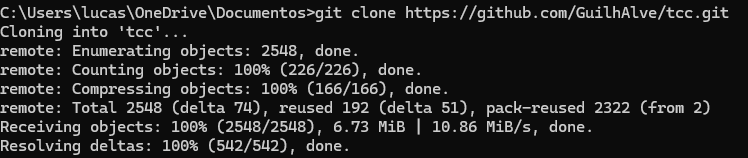
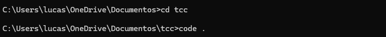
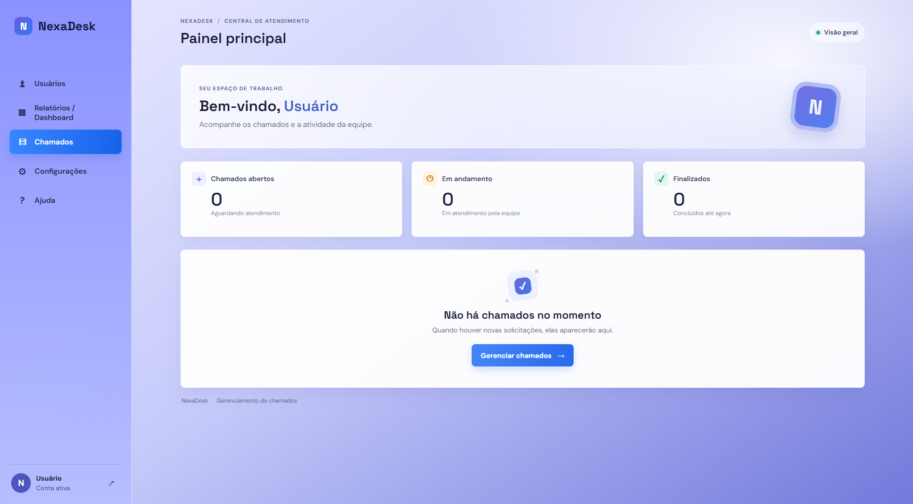
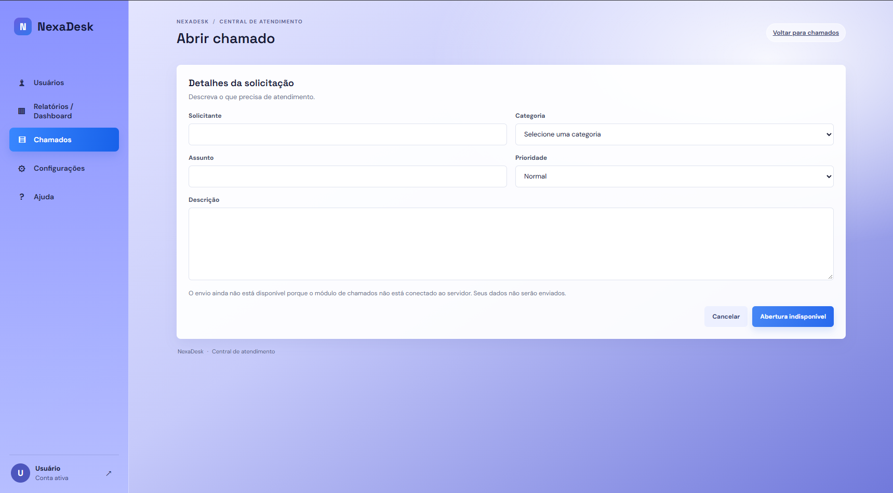

<h1>💻 Nexadesk</h1> 
<h3>Sistema de HelpDesk feito para ajudar as pessoas a resolver seus problemas relacionados à tecnologia. </h3>

<h1>📌 Sobre o projeto</h1>
<h3>A NexaDesk é uma plataforma de suporte técnico que permite os usuários registrar problemas por meio de chamados. Os administradores podem visualizar, atender e finalizar chamados após a resolução do problema.</h3>

<h1>🎯 Objetivos</h1>

<b>- Facilitar a  abertura de chamados.</b>

<b>- Registrar problemas e suas respectivas soluções.</b>

<b>- Melhorar a comunicação entre usuários e admin.</b>

<b>- Acompanhar o andamento de chamados.</b>

<h1>⚙️ Funcionalidades</h1>

<b>- Cadastro de usuários;</b>

<b>- Login;</b>

<b>- Abertura de chamados;</b>

<b>- Atendimento dos chamados;</b>

<b>- Encerramento de chamados;</b>

<b>- Sistema de notificações</b>

<b>- Dashboard de estatísticas</b>

<h1>🛠️ Tecnologias utilizadas</h1>

<b>- HTML</b>

<b>- CSS</b>

<b>- JavaScript</b>

<b>- Python/Node.js</b>

<b>- Git e Github</b>

<b>- NoSQL</b>

<h1>🎮 Como executar o sistema</h1>

<b>1. Entre em seu terminal e coloque "git clone https://github.com/GuilhAlve/tcc.git" (sem as aspas)</b>

Assim:

<b>2. Depois entre na pasta colocando "cd tcc" e depois "code ." no terminal:</b>

<b>3. No terminal do vscode, coloque "npm start" (É necessário ter o npm instalado)</b>

<h1>🚀 Exemplo simples do que o sistema faz</h1>

<b>Usuário</b>
↓

<b>Cria uma conta ou faz login</b>
↓

<b>Abre um chamado</b>
↓

<b>Administrador recebe o chamado</b>
↓

<b>Administrador resolve o problema</b>
↓

<b>Chamado é encerrado</b>

<h1>🖼️ Demonstração</h1>

<b>Tela inicial</b>

<b>Tela onde se faz os chamados</b>

<h1>👨‍💻 Desenvolvedores</h1>

<b>Produzido por: Lucas Vinicius - Guilherme Ferreira - Bryan Sena - Gabriel Ventura - Isac Lyon - Herbert Souza</b>

